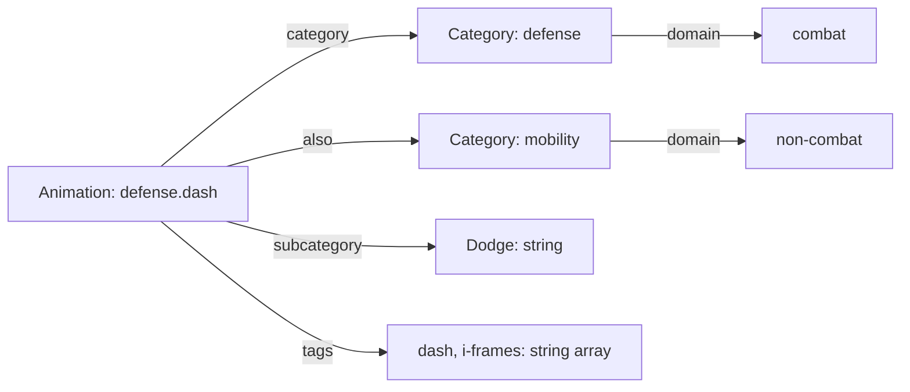
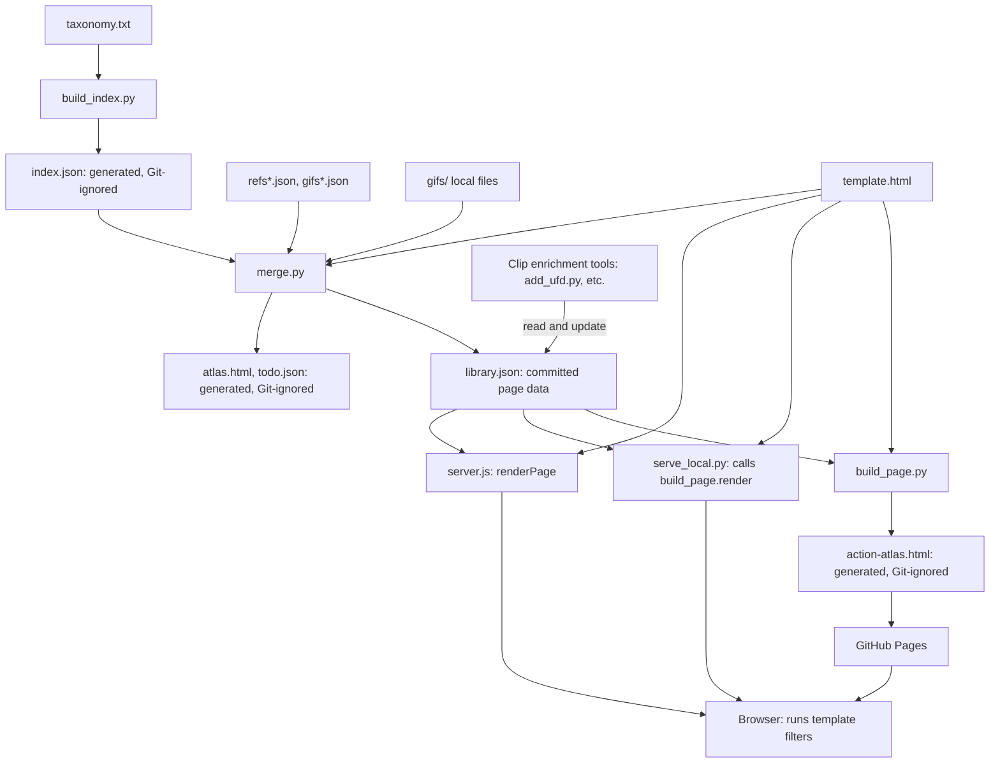
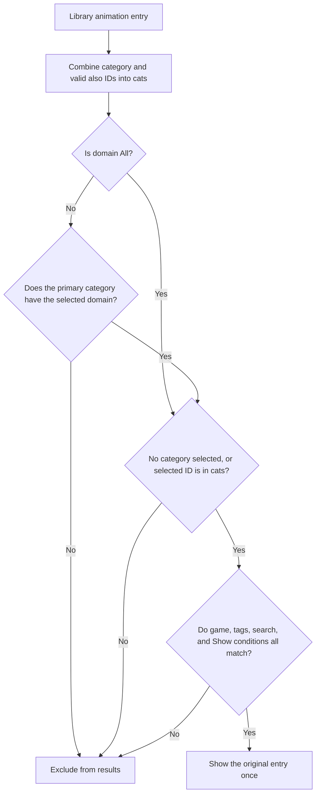

# Action Atlas Classification Architecture

## Classification principles

> **Every animation must belong to exactly one domain: Combat or Non-combat. Mobility membership must not change that domain.**

- Combat and Non-combat must be mutually exclusive and together cover every animation entry.
- Mobility is a separate grouping for finding movement animations. An entry can belong to Mobility while retaining either domain.
- Adding or removing Mobility membership must not change whether an entry appears in the Combat or Non-combat filter.
- All shows both domains together, with each entry appearing once.

For example, **Forward / Back Dash belongs to Combat and can also appear in Mobility. It must not appear under Non-combat merely because it belongs to Mobility.**

**Implementation status: compliant.** Domain filtering and detail display both use the primary category's domain. Additional category memberships affect category discovery, not domain membership. No data migration or per-animation domain field is required.

The rationale and before/after navigation diagrams are recorded in [ADR-2026-11-04-category-discovery-by-member-domain](../architecture/00-architecture-decisions.md#adr-2026-11-04-category-discovery-by-member-domain).

## Reading this document

The principles above are the agreed classification requirements. Sections 1–6 describe the current implementation. This document does not infer Xelnath's intentions. When the documented structure or behavior changes, **update the prose, examples, and Mermaid diagrams in the same change.**

Initial baseline: 2026-11-03, commit `38f508f`. Counts below reflect `library.json` at that baseline; keep them current when the corresponding data changes.

## 1. Scope and sources

Action Atlas groups examples of similar actions across games into animation entries. It currently contains 338 entries in 21 categories. An entry's `gifs` can contain clips from multiple games; an entry count is not a clip count.

| Source | Responsibility |
|---|---|
| [taxonomy.txt](../../taxonomy.txt) | Category definitions and entries' basic information, primary category, and additional categories |
| [build_index.py](../../build_index.py) | Taxonomy parsing, ID generation, and category domain assignment |
| [merge.py](../../merge.py) | Merging the generated index with reference and clip metadata |
| [library.json](../../library.json) | Committed data used by the page, including clips added by enrichment tools |
| [template.html](../../template.html) | Browser classification, search, filters, cards, and detail sheets |
| [build_page.py](../../build_page.py) | Rendering the library and template into HTML |

Move Explorer and Trends use `frame-data/games.json` and per-game data. Their games, classes, and move types are separate from the Atlas `category`/`domain` model. Atlas clips and links may refer to Move Explorer without sharing its classification automatically. See [frame-data/README.md](../../frame-data/README.md) for that data model.

## 2. Stored data and relationships

The top-level arrays in `library.json` are `categories` and `animations`. Relationships are represented by JSON ID strings, without a separate relationship table.



| Field | Shape and meaning |
|---|---|
| Category `id`, `name`, `description` | Identifier, display name, and description |
| Category `domain` | Exactly one of `combat` or `non-combat` |
| Animation `id` | Generated as `primary-category-id.name-slug`, such as `defense.dash` |
| Animation `category` | One primary category ID; the default classification shown on cards and detail sheets |
| Animation `also` | Optional array of additional category IDs; treated as empty when absent |
| Animation `subcategory` | A descriptive string, not a separate entity, ID, or category tree |
| Animation `tags` | An array of strings, filtered independently of category and domain |
| Other animation fields | `name`, `description`, `example_games`, `search_query`, `references`, `gifs`, and related metadata |

Animations do not store their own `domain`; their primary category supplies the single domain used by filters and detail display. `All` is a UI filter state, not a stored domain. Cross-listing with `also` neither copies the entry nor changes its ID. Changing the primary category or name and rebuilding the index can change the ID, so existing links and ID-based clip mappings must also be checked.

This example contains only the relevant classification fields from the actual Dash entry:

```json
{
  "categories": [
    { "id": "defense", "name": "Defense & Evasion", "domain": "combat" },
    { "id": "mobility", "name": "Mobility & Movement", "domain": "non-combat" }
  ],
  "animations": [
    {
      "id": "defense.dash",
      "name": "Dash",
      "category": "defense",
      "subcategory": "Dodge",
      "also": ["mobility"],
      "tags": ["dash", "i-frames"]
    }
  ]
}
```

## 3. Categories and domain assignment

`build_index.py` assigns `combat` when a category ID appears in its hard-coded `combat` set; otherwise it assigns `non-combat`. It does not analyze an animation's meaning, tags, or description. Taxonomy category headers do not have a domain field. A new category defaults to Non-combat unless the Combat set is also changed.

| Category ID | Display name | Domain |
|---|---|---|
| `locomotion` | Combat Locomotion | `combat` |
| `melee` | Melee Attacks | `combat` |
| `ranged` | Ranged & Firearms | `combat` |
| `magic` | Magic & Abilities | `combat` |
| `defense` | Defense & Evasion | `combat` |
| `reactions` | Hit Reactions & Status | `combat` |
| `death` | Death & Defeat | `combat` |
| `fighting` | Fighting Game Moves | `combat` |
| `enemies` | Enemy & Boss Behaviour | `combat` |
| `stealth` | Stealth & Takedowns | `combat` |
| `vfx` | Combat VFX & Game Feel | `combat` |
| `ui` | Combat UI Animation | `combat` |
| `exploration` | Exploration & Traversal | `non-combat` |
| `mobility` | Mobility & Movement | `non-combat` |
| `interaction` | World Interaction | `non-combat` |
| `expression` | Emotes & Expression | `non-combat` |
| `cartoon` | Cartoon & Classic Principles | `non-combat` |
| `creature` | Creatures & Animals | `non-combat` |
| `menu` | UI & Menu Motion | `non-combat` |
| `cinematic` | Cinematic & Narrative | `non-combat` |
| `sports` | Sports, Racing & Rhythm | `non-combat` |

## 4. Data generation and page delivery

In the taxonomy, a `# CAT id | Name | description` header sets the primary category for the entries that follow it. Entry lines use this format; the last field is optional and separates multiple additional category IDs with commas:

```text
Name | Subcategory | tags,comma,separated | Game;Game | Description | additional-category-ids
```

`build_index.py` writes that last field to `also`. It generates a slug by lowercasing the name, replacing runs of characters outside `a-z` and `0-9` with `-`, and trimming surrounding hyphens. An assertion checks for duplicate animation IDs; there is no comprehensive schema validation of category references.



- `merge.py` starts from `index.json`, fills `references` and `gifs`, and rewrites `library.json`. This path takes at most six references and four clips per entry. Enrichment tools can add more afterward, so these are not limits on the final library.
- Tools such as [add_ufd.py](../../add_ufd.py) and [tools/er_gifs/add_to_library.py](../../tools/er_gifs/add_to_library.py) read the existing library and add clips. Rerunning `merge.py` alone does not necessarily preserve data added directly to the library. Review the library diff and preservation of enriched material when rebuilding after classification changes.
- Render jobs also have an `also` field in `jobs.json`, but it lists additional **animation entry IDs** that receive the same clip. `Animation.also` in this document lists **category IDs**; these are different uses of the same field name.
- The [Pages workflow](../../.github/workflows/static.yml) builds HTML from the committed library and template. Deployment does not rerun taxonomy generation or merging.
- The [Python local server](../../serve_local.py) calls `build_page.render` per page request. The [Node server](../../server.js) injects the data in its own `renderPage` function and caches the result; it can also omit blocked or hidden clips. Both paths run classification filters from the same template.
- Approving a community animation proposal does not automatically add it to the library. The [admin code](../../lib/admin.js) exports taxonomy lines that must be incorporated and rebuilt. Its current proposal export has the five basic fields and does not export `also`.

## 5. Browser filters and display

On load, the template creates `C`, a lookup table indexed by category ID, and computes `cats`, `gk`, and `hay` on each animation. These are browser-derived fields.

```js
// Actual category-list construction: omit unknown additional categories.
a.cats = [a.category, ...(a.also || []).filter(c => C[c])];

// The domain and category conditions from base(), shown separately.
const domainMatches = st.dom === 'all' || C[a.category].domain === st.dom;
const categoryMatches = !st.cat || a.cats.includes(st.cat);
```

The primary category is assumed to exist. `cats` is not deduplicated, so data should not repeat the primary category in `also` or list the same additional category twice.



| Filter | Current matching rule |
|---|---|
| Domain | `all` imposes no domain restriction; otherwise the primary category must have the selected domain |
| Category | The selected ID must appear in `cats` |
| Tags | The entry must contain every selected tag |
| Example games | The selected game must appear in `gk`, derived from example game names using `gameKey` normalization |
| Search | Every whitespace-separated query word must appear in lowercase `hay`, which combines name, description, subcategory, tags, example games, and primary/additional category names |
| Show | All enabled conditions apply: GIF presence, marked entries, downvote flags, and entries needing replacement |

Different filters are combined with AND. `subcategory` contributes to search and detail display but has no independent selection filter or grouping header. Initially the domain is `all`, no category or game is selected, tags and search are empty, and Show conditions are off.

Category buttons in both the sidebar and the top category ruler use **the domains of their member entries**, including primary and additional memberships. All shows every category. Combat and Non-combat show a category when at least one member entry's primary category has the selected domain. The shared `categoryAvailable` helper checks only domain and membership, so search, game, tags, and Show filters cannot hide these buttons; they can reduce a displayed count to zero. Category counts ignore only the current category condition and count each matching entry under its `cats`; All categories counts entries. The sum of category counts can therefore exceed the total entry count. Game and tag counts similarly ignore their own filter condition while retaining the others.

The header summary beside the domain buttons updates on every render and depends only on the selected domain. It counts each entry once using its primary category's domain and counts categories using the same availability rule as the sidebar and ruler. All shows `338 entries · 21 categories`, Combat shows `220 entries · 13 categories` (including Mobility), and Non-combat shows `118 entries · 9 categories`. Category, search, game, tag, and Show filters do not change this summary, even when they produce zero results; the results heading separately reports the filtered animation, GIF, and reference counts.

Cards show the primary category name. The detail sheet's Domain and Category also come from the primary category; additional categories appear as separate `Also in` buttons. Clicking one closes the sheet and selects that category. It preserves the current domain whenever the target category has any member entry in that domain, using the same `categoryAvailable` helper as the menus. Only a target with no members in the current domain changes the domain to All. Other filters such as search, game, tags, and Show remain active, even when they leave no matching results. Clicking a top-level domain button clears the category selection.

The Tags heading includes a sort selector: **Alphabetical (A–Z)** (the default) or **Most used**. Alphabetical mode uses English name collation; Most used sorts by the tag counts described above, descending, with the same name order for ties, and displays counts other than one beside their tags in smaller, muted body text without parentheses. Alphabetical mode displays tag names without counts. Initially only the first 48 tags are shown. If more exist, a `...` button appears as the 49th item with the accessible name `Show all tags`. Activating it reveals all remaining tags in the same order, removes the button, and focuses the first newly revealed tag. Selected tags that no longer match the other filters remain in the sorted list with a count of zero and follow the same display limit; selected tags hidden by the limit can still be removed from the active filter area. Sorting and expanding only update the tag buttons, without changing active filters or animation results. The existing sidebar scroll and mobile filter panel contain the list.

The sort selector uses small, muted body text with a transparent background and no border beside the Tags heading. Hover increases text contrast; keyboard focus uses the shared visible focus outline. The native select options use the current theme's background and text colors where supported by the browser.

The tag sort preference is saved in browser local storage under `atlas.tagSort` (`alphabetical` or `usage`) and survives Clear all and page reloads. Missing, invalid, or unreadable preferences default to alphabetical order; sorting still works when storage is unavailable.

The expanded state is held only in page memory. It survives sort and filter changes, including Clear all, but is never saved: reloading restores the 48-tag limit while preserving the saved sort preference. Lists with 48 or fewer tags have no expansion button.

Category selection itself is not stored in the URL. Current hash routes handle entry details and submission/proposal screens.

## 6. Mobility example and access paths

Mobility was added in `3c8dd5e` and merged in `48ffc78`. Existing entries retain their primary categories and gain `also: ["mobility"]`; only the new entries use mobility as their primary category.

| Primary category | Entries shown under Mobility |
|---|---:|
| Combat Locomotion | 11 |
| Magic & Abilities | 1 |
| Defense & Evasion | 2 |
| Fighting Game Moves | 1 |
| Exploration & Traversal | 5 |
| Mobility & Movement: new entries | 8 |
| Total | 28 |

The eight new entries are Grappling Hook Pull, Recovery Move (Up Special), Jetpack / Hover Boost, Triple Jump / Long Jump, Rail Grind, Super Dash / Charged Dash, Ledge Shimmy / Wall Sidle, and Skydive / Wingsuit.

The main access path is **Action Atlas > All, Combat, or Non-combat > Category: Mobility & Movement > entry card**. On narrow screens, Filters opens the category list. The top category ruler, a `mobility` search, and an existing entry's `Also in` button provide other entry points. With no other filters, the category shows 28 entries under All, 15 under Combat, and 13 under Non-combat. From Forward / Back Dash in Combat, clicking `Also in > Mobility & Movement` keeps Combat selected and shows the 15 Combat members.

| Where Dash is viewed | Result |
|---|---|
| All | The original Dash entry appears once |
| Combat | Included through Defense's domain |
| Non-combat | Excluded because the primary category is Combat |
| Mobility & Movement | Included through `also` when All or Combat is selected; excluded under Non-combat |
| Dash card and detail sheet | Primary category remains Defense & Evasion; the detail sheet adds Dodge and reports Domain as Combat |

Combat and Non-combat are mutually exclusive sets of entries: 220 Combat and 118 Non-combat entries form the 338-entry All result. Cross-listing can span categories from both domains without changing an entry's primary domain. The Mobility category button appears in all three domain views because it has members in both domains; use All to browse the complete Mobility collection.

Mobility does not automatically collect every movement animation. Only explicit primary or additional memberships include an entry. For example, Jump and Crouch Walk are included, whereas Run Cycle and swimming entries currently are not. Its subcategories mix spatial labels such as Air/Ground with movement methods such as Dash/Jump/Grapple, and the page displays them in a single card list.

## 7. Maintenance and verification

Update this document in the same change when modifying any of the following:

- Classification fields, ID generation, domain assignment, the category list, or cross-listing relationships.
- Domain, category, subcategory, tag, or search behavior; classification display or access paths.
- Data generation, merging, clip enrichment, page delivery, or data facts reflected in the tables, examples, and counts.

Compare the document with the actual `library.json`, scripts, and template. Check relative links and Mermaid syntax. Verify that Combat and Non-combat results are disjoint and their union equals All, with each entry appearing once. Forward / Back Dash must appear under Combat and All but not Non-combat. Mobility shows 28 entries under All, 15 under Combat, and 13 under Non-combat. Adding or removing additional Mobility membership must not change domain results. Check search combinations and agreement with the detail sheet's domain. Sidebar and ruler categories must agree and remain visible with zero counts caused by other filters. Check that `Also in` preserves the domain when the target has members in that domain, switches to All only when it has none, and preserves other filters in either case. Existing entry links and clip mappings must remain intact.

A clip-only replacement that does not change the documented structure or facts needs no documentation update. This document is not automatically generated, and CI does not enforce synchronization. The maintenance requirement is recorded in [AGENTS.md](../../AGENTS.md) and [CLAUDE.md](../../CLAUDE.md).
