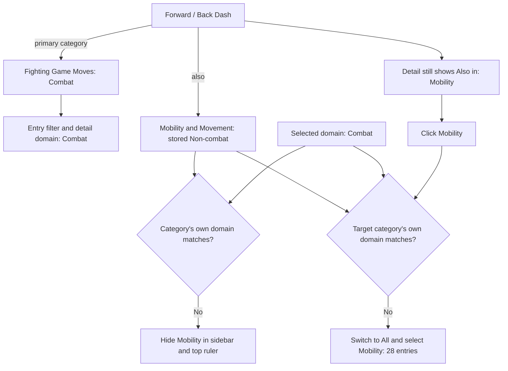
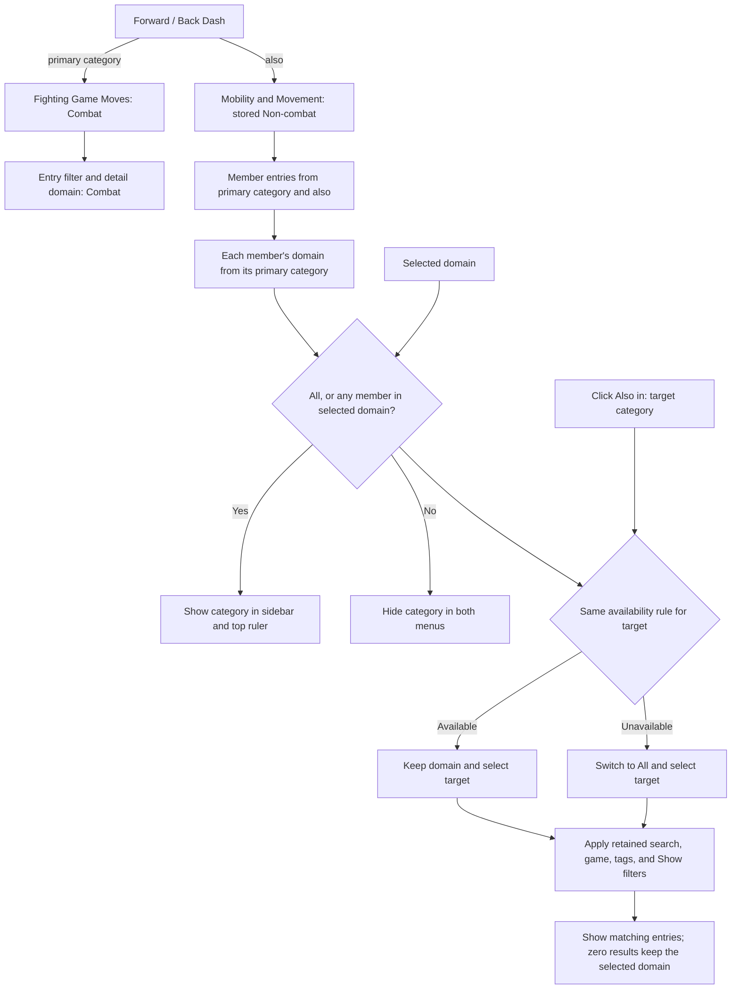

# Architecture Decision Records

Decisions use stable `ADR-YYYY-MM-DD-slug` identifiers, with the decision date and a lowercase kebab-case summary. Record a replacement decision under a new ID and mark the previous decision as superseded rather than removing its history.

The [classification architecture](../architectgure/architecture.md) describes the current implementation. This document records why the decisions were made.

## Decision summary

| ADR | Decision | Rationale |
|---|---|---|
| [ADR-2026-11-04-category-discovery-by-member-domain](#adr-2026-11-04-category-discovery-by-member-domain) | Discover categories through their members' domains | Make cross-listed movement entries accessible within Combat without changing their domain classification |

## ADR-2026-11-04-category-discovery-by-member-domain

**Status:** Approved; implemented in the working tree.

**Date:** 2026-11-04.

### Context

Action Atlas helps learners find and compare examples of similar actions across games. An entry has one primary category and can have additional category memberships in `also`. Its primary category supplies its single domain, Combat or Non-combat.

Before this decision, entry filtering already used only the primary category's domain. The earlier behavior in which additional Mobility membership also granted Non-combat membership had already been corrected. This ADR addresses the remaining navigation inconsistency, not that earlier filtering change.

Category navigation still checked each category's own stored domain. Mobility & Movement is stored as Non-combat, so its sidebar and top ruler buttons disappeared in Combat, even though 15 Combat entries belong to Mobility. The Forward / Back Dash detail sheet still displayed `Also in: Mobility & Movement`. Clicking that button from Combat switched to All because Mobility's stored domain differed from the selected domain.

This made a valid membership visible in the detail sheet but unavailable as a category filter within the same domain.

### Decision

1. **Preserve entry domains.** An entry's primary category remains the only source of its Combat/Non-combat domain. Additional membership never changes that domain.
2. **Discover categories through their members.** All shows every category. Combat and Non-combat show a category if at least one member entry has the selected domain. Both primary and valid additional memberships count.
3. **Share the availability rule.** The sidebar, top ruler, and detail-sheet category navigation use `categoryAvailable(id)` in [template.html](../../template.html). Availability depends only on domain and membership, independently of search, game, tags, and Show filters.
4. **Keep zero-count categories discoverable.** Other filters can reduce a category's count to zero without hiding its button. Counts still respect every active filter except the current category selection.
5. **Preserve browsing context.** Clicking `Also in` closes the detail sheet and selects the target category. Keep the current domain if that category has members in it; otherwise switch to All. Preserve search, game, tags, and Show filters in either case. An empty result caused by those other filters does not trigger a switch to All.

### Before: category metadata controls navigation

This diagram represents the implementation immediately before this decision. Entry domain filtering had already been separated from additional membership.

### After: member domains control navigation

The stored relationships stay the same. The structural change is that both navigation paths depend on member availability rather than the target category's own domain.

### Observable behavior

Counts below assume no search, game, tag, or Show filters.

| Domain | Mobility before | Mobility after | Forward / Back Dash after |
|---|---|---|---|
| All | Visible; 28 entries | Visible; 28 entries | Included once |
| Combat | Hidden despite 15 matching members | Visible; 15 entries | Included once |
| Non-combat | Visible; 13 entries | Visible; 13 entries | Excluded |

From the Forward / Back Dash detail sheet in Combat, `Also in > Mobility & Movement` now retains Combat and shows its 15 Mobility members. A search with no matching entries leaves Mobility visible with a zero count and does not switch the domain.

### Alternatives considered

| Alternative | Reason not selected |
|---|---|
| Change Mobility's stored domain to Combat | Moves the navigation problem to Non-combat and changes the domain of entries whose primary category is Mobility |
| Always show every category in every domain | Exposes categories with no members in the selected domain; member-based discovery offers relevant categories while retaining zero counts caused by other filters |
| Show categories only when their fully filtered count is positive | Makes navigation disappear as search, game, tags, or Show filters change |
| Add multiple domains per entry or redesign the taxonomy | Exceeds this navigation change and conflicts with the existing requirement that entry domains be mutually exclusive |

### Consequences and compatibility

- Category visibility can change when cross-listing changes, but entry domain membership cannot. Combat and Non-combat remain disjoint sets of 220 and 118 entries, covering all 338 entries.
- A category's stored domain classifies its primary entries; it no longer limits which domain views can expose that category. Cross-listed entries retain their own primary category's domain.
- No public API, stored schema, ID, taxonomy membership, clip mapping, or hash route changes. `categoryAvailable(id)` is a browser-internal helper. Existing shared links continue to open the same entries.
- All still exposes empty category definitions. A domain-specific view requires at least one member in that domain, even when the category's own domain matches.
- Mobility keeps its current 28 curated members. Expanding it to every movement action and introducing movement-method filters remain separate product decisions.
- The change ships through the existing template rendering paths; no data migration or index/metadata merge is needed.

### Verification

Headless Chrome checks against the local Node server verified:

- Mobility visibility and unique counts of 28, 15, and 13 under All, Combat, and Non-combat; sidebar and ruler agreement.
- Forward / Back Dash inclusion under All and Combat, exclusion under Non-combat, and continued access through its existing hash and clip detail.
- Combat retained when navigating through `Also in`, including combined search, game, tag, and GIF filters and zero-result searches.
- Zero-count buttons remain visible, and removing additional Mobility membership in browser memory does not alter the entry's domain results.
- The fallback to All preserves other filters when a target has no members in the current domain. This used a temporary browser-only membership fixture: current additional memberships target Mobility, which has members in both domains.
- Mobile Filters at a 390-pixel viewport expose Combat > Mobility and its 15 entries.

These checks establish functional behavior; they do not establish a measured improvement in learning or usability.
